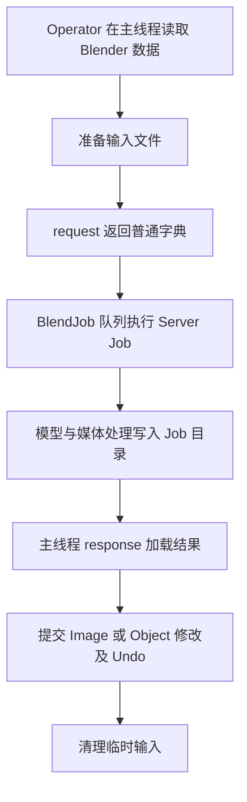

# 程序架构

| 模块 | 职责 |
| --- | --- |
| `__init_base__.py`、`__init__.py` | 基础版与完整版的类型、工具、菜单、快捷键注册，以及完整版 Runtime 生命周期 |
| `menus.py`、`ai_menus.py`、`panel.py` | 图片上下文菜单、AI 操作入口与服务器面板 |
| `preferences.py`、`ai_preferences.py` | 公共工具设置、AI 设置、设备与模型枚举及读取入口 |
| `properties.py`、`ai_properties.py` | 基础与 AI Scene 属性、手势与参考状态、参考生命周期和 Operator 属性构造 |
| `tools.py`、`ai_tools.py` | 3D View WorkspaceTool 声明、顺序与注册 |
| `keymaps.py` | 扩展快捷键的注册与清理 |
| `common/` | Blender 侧公共能力 |
| `operators/` | 交互、任务参数、结果导入和 Undo |
| `server/` | 独立环境内的媒体处理、推理和产物写出 |

## 注册与配置

`__init_base__.py` 与 `__init__.py` 分别直接导入本版的类型，在各自的 `CLASSES` 中按设置、Operator、Menu、Panel 逐项列出，并各自直接遍历静态清单注册，注销时反序遍历同一清单。生成任务类型先于对应操作入口注册。完整版从公共与 AI 翻译目录组合译文。

顶层入口注册类型后，通过 `tools.py` 组织 WorkspaceTool，通过 `keymaps.py` 注册快捷键。注销时关闭 Runtime、清理参考资源、快捷键、菜单、Scene 属性和工具，最后按 `CLASSES` 逆序注销类型。公共设置与 AI 设置分别在 `preferences.py`、`ai_preferences.py` 定义，均通过 `addon_preferences()` 读取。基础文件只依赖基础能力，AI 文件在其上扩展。

**处理分辨率上限** 限制模型分析输入和**2倍高清**可提交源图的长边；**画框分辨率上限** 限制**重设画框**输出长边；**最小相对边长** 与 **边界扩展** 控制**立体裁切**的网格密度和轮廓边界采样。

## 执行边界

**面片**、**重设画框**、**局部显隐**、**透视校正**、**色彩匹配**、**烘焙网格**和无需 AI 的**立体裁切**在 Blender 内执行。Server 的 `jobs/` 编排任务，`models/` 负责模型适配，`geometry/` 处理深度与法线产物。Server 模块通过内部相对导入共享能力，Blender 侧通过 `common/` 复用。

MoGe-2 与 MoGe-3 输出统一为 `GeometryFrame`：包含 Depth、Validity、Intrinsics，以及按需提供的 Normal 和 Points。产物写入器消费同一个 `GeometryFrame`，保持深度、法线和相机数据一致。参见 [Runtime](runtime.md) 与 [产物协议](outputs.md)。

## 对象与模型状态

Any Image 创建的图片 Mesh 通过 `o_image_object` 提供对象图片操作。Bake 成功后固化网格并移除该标记，结果成为普通 Mesh；Undo 恢复原节点栈和能力。Shader Editor 的贴图节点继续按活动编辑树解析目标。

`common/ai.py` 统一读取模型安装状态和 Runtime 快照；模型枚举直接读取静态目录，同一次 UI 绘制复用一份状态。服务端在创建 Session 前校验文件内容，并以模型 key 发布状态；档位统一来自模型目录。流程见 [Runtime](runtime.md)。
