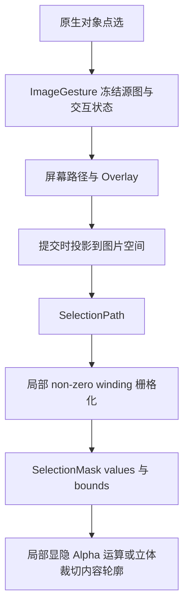

# Blender 公共能力

`src/anyimage/common/` 按业务职责提供公共函数，调用方从对应模块直接导入。

| 模块 | 职责与主要入口 |
| --- | --- |
| `ai.py` | 环境与模型状态、就绪检查、安装和模型下载入口、输入路径校验、`production_device()`、`geometry_job_parameters()` 与安装 UI |
| `image.py` | `image_rgba()`、Image User 帧设置读取、像素采样与摘要、真实引用检查、结果 Image 和 `replace_empty_image()` |
| `image_input.py` | 创建独立输入快照、导出当前像素和清理临时输入文件 |
| `job_image.py` | 校验排队任务的图像目标、准备 AI 分析输入，加载产物并通过 `ImageEditTarget` 提交结果 |
| `color_image.py` | 材质颜色文件的准备、清理、颜色空间设置和归一化 |
| `hdr_image.py` | HDR 分析颜色、EXR 保存和浮点图片创建 |
| `image_target.py` | Image Empty、带能力标记的 Mesh 与 Shader Image Texture 编辑目标 |
| `selection.py` | `SelectionPath`、`SelectionMask`、non-zero winding 栅格化与 Alpha 修整 |
| `viewport.py` | 原生点选、屏幕投影、`ImageGesture`、**套索** / **画笔** / **折线**与 Overlay |
| `image_plane.py` | 公共矩形网格、坐标变换与基础面片创建 |
| `geometry_image.py` | 深度图片和元数据加载、相机坐标与显示范围的尺度换算、深度方向拟合与节点坐标转换 |
| `color_reference.py` | 参考签名、内容摘要、色板、缩略图及交互资源引用 |
| `color_match.py`、`color_palette.py`、`color_space.py` | 色板锚点匹配、亮度曲线、代表色提取与颜色转换 |
| `image_preview.py` | GPU 预览纹理、显示编码、布局和 HUD 绘制 |
| `projective_image.py` | 透视变换与预乘 Alpha 插值 |
| `polygon.py` | 屏幕多边形、**画笔**轮廓、扫描线区间和预览网格 |
| `material.py` | `O Texture to Layer`、Normal、Alpha、**无光照**与全景材质 |
| `bake.py` | `bake_context()` 创建隔离的 Cycles 烘焙场景并清理临时对象 |
| `object.py` | Modifier 输入设置与结果对象激活、源对象替换 |
| `node.py` | `node_asset_path()` 与 `load_node_group()` |

## 图像生命周期

业务像素采用 Top-down RGBA，`image_pixels()` 使用 Blender 像素顺序。预乘采样用于投影插值；文件或 Packed 图像的业务读取保留隐藏 RGB。`ImageEditTarget` 校验目标绑定、颜色解释与像素摘要后，经 `replace_empty_image()` 或 `replace_texture_image()` 提交。未共享的 Image 原地替换内容；其他 Empty、材质或纹理仍引用源图时，为当前目标使用独立 Image，共享材质也按当前对象隔离。失败时回滚源数据。同一目标的排队任务跟随成功提交更新基线，外部改图后新提交使用新的目标状态。

`image_input.py` 的 `prepare_image_input()` 为当前图像准备独立快照：未改动的文件直接复制，Packed、未保存修改和 Generated 图像导出当前像素；`cleanup_image_input()` 与创建方配对。`hdr_image.py` 将 HDR 像素映射为分析预览，并复用 `color_space.py` 的 sRGB 编码。`color_image.py` 的 `prepare_material_color_input()` 准备材质颜色，`job_image.py` 的 `material_analysis_input()` 提供分析输入；**立体裁切**按几何 bounds 裁切。

## 颜色参考生命周期

`properties.py` 管理各 Scene 的参考选择、画廊与色板同步，并注册 load、Undo、Redo 回调和 `image_content_handlers` 的编辑通知。公共参考模块准备签名、色板与缩略图，使用像素摘要检查内容身份。长期缓存保留紧凑派生数据，完整像素只在准备及匹配交互期间使用。

Scene 清空或替换参考时，按其他 Scene 与活动交互的引用释放资源。匹配确认、取消和失败会结束交互引用；扩展注销清理自身 handler 与预览资源。

## 手势与 Selection

简单多边形预览由 Blender 的 `mathutils.geometry.tessellate_polygon()` 三角化；自交轮廓使用 non-zero winding 扫描线填充。

**画笔**的圆形印记和连接条由 `brush_footprint_polygons()` 生成，供预览与提交共用。拖动时维护屏幕路径与局部 Overlay，提交时生成覆盖值。**局部显隐**、**透视校正**与**立体裁切**的空命中保留 active Image Empty；点中另一对象时完成原生选择。

## 材质、节点与对象

`create_image_material()` 按**无光照**、法线空间和全景用途组合节点、连接颜色与 Alpha。材质颜色处理读取 Scene 的 View Transform，保留 HDR，并分别处理普通表面的颜色归一化与全景颜色反变换。`set_modifier_input()` 按 Blender 版本的实际输入 API 设置值，`finalize_object_result()` 完成结果对象激活和源对象处理。Image 替换路径保留 Empty 的矩阵、显示尺寸、偏移和 Image User 帧设置。

`linear_color_rgba()` 统一读取直通 Alpha 的线性 RGB，供发光编码和亮度统计使用。`Highlight Threshold` 根据完整原图的亮度直方图和空间对比估计：普通物体比较四角与中心，全景比较下方与上方区域。统计包含透明区域保留的 RGB；Alpha 用于确认是否存在 `alpha > 0.1` 的有效区域。没有有效区域、数据非有限或亮度完全一致时返回 1。裁切材质沿用完整原图在相同颜色解释下算出的阈值。

`O Texture to Layer` 在阈值 `t` 到 `4t` 之间平滑增加发光并抑制颜色 Bump。`Bump Scale` 默认 1、范围 -10 到 10，乘以 0.01 作为凹凸距离，正负控制方向；创建材质时直接沿用节点组默认值。Roughness 使用独立的亮度映射。

Geometry Nodes 从 `src/anyimage/assets/O_AnyImage.blend` 按公开名称加载。构建与布局职责见[节点资产](node-assets.md)，深度字段见[Job 产物](outputs.md)。
