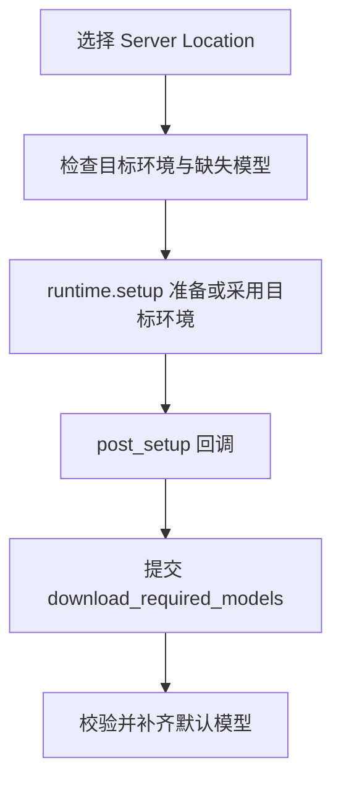

# AI 环境管理

`operators/ai_setup.py` 提供 AI 环境安装、模型下载、偏好设置和模型缓存释放入口。环境与服务器生命周期由 BlendJob 管理。

## 执行过程

`SetupAIServer` 在 Runtime 状态为 `UNAVAILABLE` 时可用。用户选择目标目录后，对话框预览环境是否已安装、缺失模型及下载量；Runtime 在执行时重新校验目录。

## 安装独立环境

`SetupAIServer.execute()` 调用 `runtime.setup(target=..., mirror=..., online=...)`。`use_mirror` 决定 uv、Python 和安装包的下载源，模型使用模型目录中声明的来源。

安装完成后，`runtime.py` 的 `prepare_models()` 作为 `post_setup` 回调，在主线程通过 `runtime.submit()` 提交默认模型下载任务。进度由 BlendJob 显示，模型依赖加载于独立 Server 环境。

## 下载模型

`DownloadModel` 校验环境与 Blender Online Access，提交单个模型的 `download_model` Job；`DownloadRequiredModels` 校验环境，将默认模型集合及联网策略交给 `download_required_models` Job。Server 校验文件并下载缺失或损坏的模型。

Job 在 `server/__init__.py` 注册；`server/model_catalog.py` 保存模型名称、文件和来源，`server/model_download.py` 下载并校验文件，`server/model_manager.py` 管理模型目录与已加载 Session。下载进度和错误通过同一套 BlendJob Runtime 返回 Blender。

## 设置与模型缓存

`OpenAIEnvironmentSettings` 打开扩展首选项。`UnloadModels` 在 Server 空闲时调用 `runtime.clear_resource("model_manager")`，释放已加载的模型 Session；下次推理从模型目录重新加载。

环境未安装时，操作入口调用 `SetupAIServer`；环境可用而默认模型未齐时，调用 `DownloadRequiredModels`。三个默认模型全部就绪后开放 AI 功能。模型选择项由 `ai_preferences.py` 读取静态目录，安装与校验状态由 `common/ai.py` 查询。
