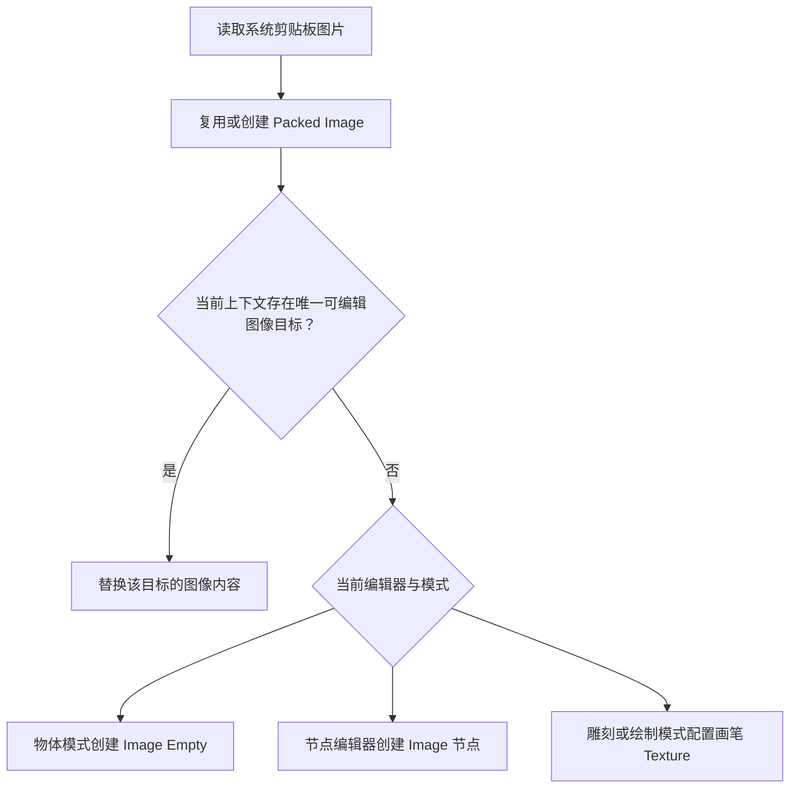

# 剪贴板图片

`PasteClipboardImage` 将系统剪贴板图片读取为 Packed Blender Image。快捷键在 `keymaps.py` 中注册：3D View 和 Node Editor 使用 **Ctrl+Shift+V**，macOS 使用 **Cmd+Shift+V**。

`clipboard.py` 处理平台差异。Windows 依次尝试 PNG、DIBV5 和 DIB，DIB 补成 BMP；macOS 通过 `osascript` 导出 PNG；Linux 依次尝试 `wl-paste` 和 `xclip`。输出统一为图片字节和扩展名。剪贴板没有图片时 Operator 返回 `PASS_THROUGH`。

`actions.py` 根据图片字节 SHA-256 查找缓存，并校验当前像素与颜色解释；可复用时使用已有 Packed Image，否则加载并打包新图像。

在 3D View 物体模式中，新图像以 Image Empty 放到鼠标对应的视图位置，尺寸与拖入参考图像一致。Node Editor 根据节点树类型创建图片节点；World 着色节点使用 Environment Texture。雕刻和绘制模式将图像配置到当前画笔的 Texture，保留笔刷本地化和预览更新。

若当前唯一选中的图像 Empty、图片节点或活动笔刷已有可编辑静态图像，粘贴会替换该目标。共享图像为当前目标创建独立结果，未共享图像原地更新；失败时恢复原内容与引用。其他目标设置保持不变。
