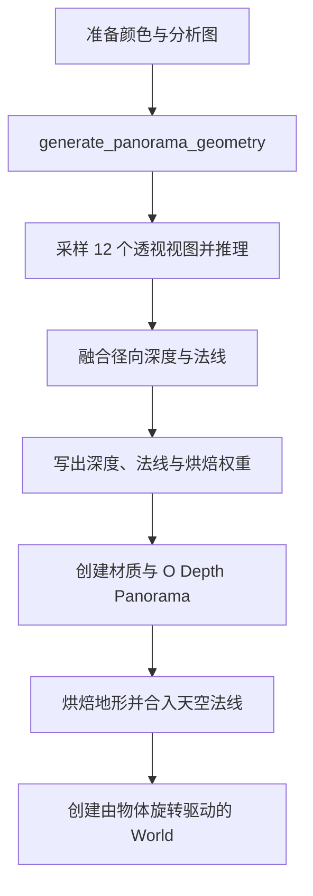

# 转为立体全景

`operators/convert_to_panorama/` 将静态等距柱状 Image Empty 转换为径向深度表面，提交前裁剪出最大居中 2:1 区域。`operators.py` 提交任务，`object.py` 导入对象，`normal.py` 烘焙地形法线，`world.py` 创建环境光照。

任务使用偏好设置选择的几何模型。`geometry/panorama.py` 负责视图采样与融合，`geometry/panorama_relief.py` 以深度为方向基准恢复地形细节，并为天空生成朝内的球面法线。`jobs/panorama.py` 编排推理与写入，深度和法线共用 **Maximum AI Input Size** 的宽度上限。

对象以源 Empty 的位置为全景中心，继承缩放。地形烘焙在 `Subdivide = 6`、`Depth Mask` 开启、`Horizon Bend = 0` 时采样网格法线，按烘焙权重与模型法线过渡。烘焙使用求值网格的 `UVMap`，天空直接取 Server 生成的球面法线。合成后打包 RGB 对象空间法线贴图，并释放临时法线和权重图像。材质独立控制颜色 Bump。成品网格的 `Horizon Bend` 设为 `-0.1`，World 通过 `O Background` 显示由物体旋转驱动的全景环境。导入失败时释放本次创建的数据并恢复原 World，成功后记录 Undo。
