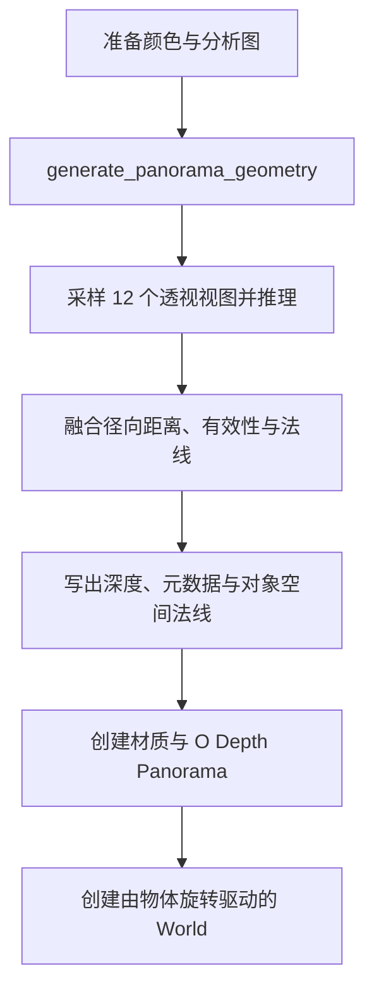

# 转为立体全景

`operators/convert_to_panorama/` 将静态等距柱状 Image Empty 转换为径向深度表面，提交前裁剪出最大居中 2:1 区域。`operators.py` 提交任务，`object.py` 导入对象，`world.py` 创建环境光照，`__init__.py` 汇总导出与注册清单。

任务使用 Preferences 选择的几何模型。源颜色由 Blender 侧保存，Server 的 `geometry/panorama.py` 负责视图采样与距离融合，`jobs/panorama.py` 编排推理和产物写入。

对象以源 Empty 的位置为全景中心，继承缩放。`O Depth Panorama` 根据径向深度生成表面，`O Texture to Layer` 使用全景颜色和对象空间法线生成材质输入。转换同时将场景 World 设为使用 `O Background` 的全景环境，环境贴图旋转由物体的世界旋转驱动。导入失败时释放本次创建的数据并恢复原 World；成功后记录 Undo。
