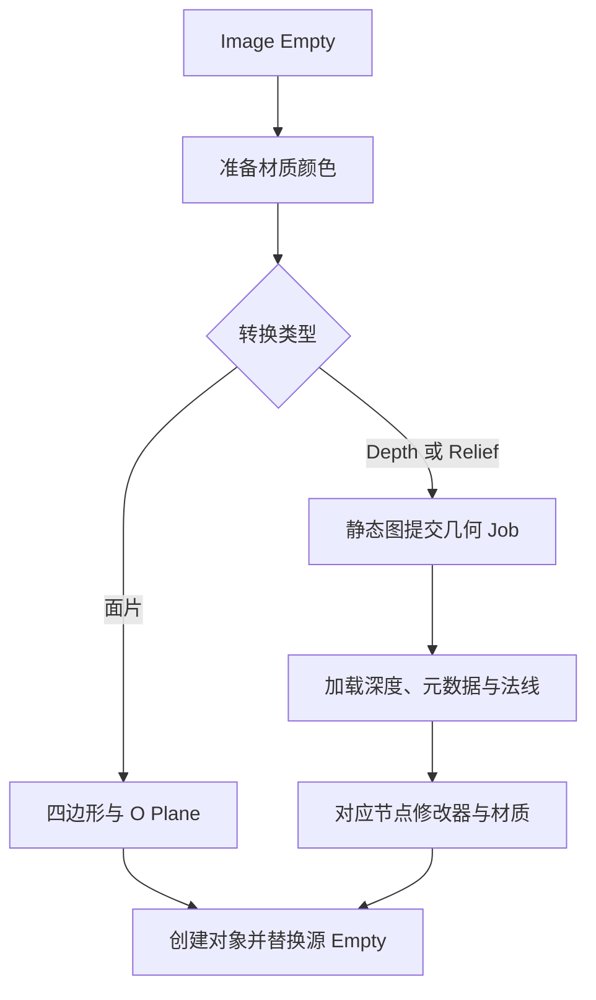

# 转为面片、转为凹凸面与转为浮雕

普通面片入口位于 `operators/convert_to_plane.py`，通过 `common/image_plane.py` 创建基础矩形网格与面片。凹凸面与浮雕集中在 `operators/depth_plane/`：`operators.py` 定义两个转换入口和内部任务 `GeneratePlaneGeometry`，准备输入快照并提交几何 Job；`object.py` 导入深度产物、创建对象并提交 Undo；`__init__.py` 导出 Operator。两个转换入口分别指定固定的 Depth 或 Relief 类型。

三种转换都只接受静态图片。基础网格以局部中心为原点，对象矩阵补偿源 Empty 的显示范围。

Depth 与 Relief 从 Preferences 读取几何模型、分辨率级别和 AI 输入上限。`create_depth_plane_from_result()` 导入产物并创建修改器。排队时保留源 Object 和 Image 的原生引用，回填时校验其绑定与图像内容摘要，重命名保持任务有效，等待期间换图或修改像素、尺寸、颜色解释会拒绝回填。`O Depth Plane` 使用相机 XYZ 与对象空间法线构建深度表面；`O Depth Relief` 使用深度 Z 与切线空间法线构建浮雕。

节点构建见[节点资产](../node-assets.md)，文件协议见[Job 产物](../outputs.md)。
