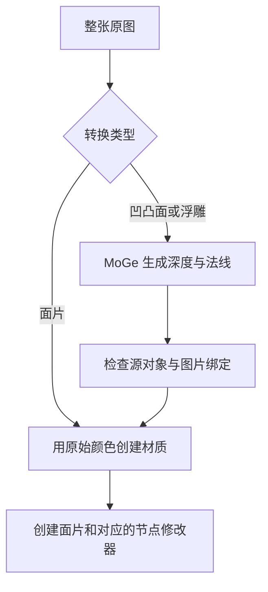

# 转为面片、转为凹凸面与转为浮雕

普通面片入口位于 `operators/convert_to_plane.py`。`operators/depth_plane/operators.py` 将整张图提交给 MoGe，`object.py` 在结果返回后用提交时留下的颜色贴图创建材质，并用深度与法线创建对象。三种面片共用 `common/image_plane.py` 的基础矩形网格。

三种转换都只接受静态图片。基础网格以局部中心为原点，对象矩阵补偿源 Empty 的显示范围。

Depth 与 Relief 从 Preferences 读取几何模型、分辨率级别和 AI 输入上限。`create_depth_plane_from_result()` 导入产物并创建修改器。Blender 在提交时留存颜色贴图。回填时，原场景中的源 Object 仍绑定同一 Image 就可替换，材质与几何都使用提交时的图像尺寸和内容。`O Depth Plane` 使用相机 XYZ 与对象空间法线构建深度表面；`O Depth Relief` 使用深度 Z 与切线空间法线构建浮雕。

节点构建见[节点资产](../node-assets.md)，文件协议见[Job 产物](../outputs.md)。
