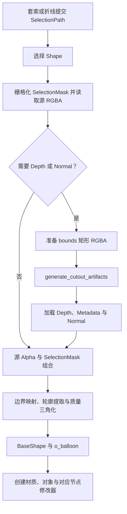

# 立体裁切

**立体裁切**在静态 Image Empty 上圈定 Selection，按轮廓创建**面片**、**体块**、**对称凹凸**或**凹凸体块**。本地创建入口位于 `operators/cutout_tool/operators.py`，AI 任务入口位于 `ai_operators.py`。WorkspaceTool 声明位于 `tools.py`，Shape 菜单位于 `interaction.py` 与 `ai_interaction.py`，预设标签与节点组对应关系统一位于 `shape.py`。

| 预设 | 节点组 | AI 产物 |
| --- | --- | --- |
| **面片** | `O Cutout`，Thickness 0 | 可选对象空间法线 |
| **体块** | `O Cutout`，Thickness 1 | 可选对象空间法线 |
| **对称凹凸** | `O Depth Cutout` 与 `O Cutout Symmetry` | 深度与对象空间法线 |
| **凹凸体块** | `O Depth Cutout` | 深度与对象空间法线 |

**面片**与**体块**可以不带 AI 产物生成；Depth 预设和**法线贴图**需要就绪的几何模型，Shape 菜单按该状态提供选项。

## 轮廓与网格

`geometry.py` 组合源 Alpha 与 Selection，提取连通轮廓与孔洞，按**边长**生成 `BaseShape`。**边长**是世界空间的网格目标边长，**最小相对边长**会按内容范围提高其下界。

`mesh.py` 负责轮廓分离、孔洞处理、质量三角化和边界支撑，`polygon.py` 提供轮廓简化，`tangle.py` 是随包分发的 Delaunay 三角化核心，按目标边长计算最大三角形面积，并以 10° 为质量细分的最小角目标。**精细轮廓**展开时保留小孔与细节轮廓，关闭时填洞并简化。

`balloon.py` 负责 **体块鼓起算法**，按 Preferences 选择 Poisson 或 Teddy，生成所有预设共用的 POINT 属性 `o_balloon`。`boundary_padding.py` 按**边界扩展**沿结构内法线重采样轮廓附近的颜色与深度。

## AI 与对象创建

Server 接收 Selection bounds 内保留源 Alpha 的 RGBA，一次 MoGe 推理按 `generate_depth` 与 `generate_normal` 返回产物。法线转换为网格本地 XZ 坐标系，保存为 `object-normal.png`。深度参考区域使用所选**透明度阈值**；**处理分辨率上限**只影响分析分辨率。

`object.py` 统一构建轮廓、扩展边界、创建材质与网格、配置修改器并提交 Undo。Depth 与 Normal 作为可选产物传入，深度形状据此计算缩放、参考值与对称方向。本地与 AI 入口共用这条构造流程，并从资产加载对应节点组。请求的法线产物缺失时报告警告并继续生成物体。基础网格位于局部 XZ 平面，厚度沿 Y 展开；对象矩阵把网格放入 Image Empty 的图片平面，**对称凹凸**额外叠加对称节点组与方向参数。Object Normal 随方向同步转换。

材质使用 IOR 1.2，颜色与对象空间法线接入 `O Texture to Layer`。没有法线贴图时使用网格法线，颜色 Bump 独立生效。`O Cutout Symmetry` 用一个 FACE 域 Vector 属性 `o_normal_transform` 传递对齐旋转、单轴缩放与镜像信息，由材质逐像素变换法线；边缘与侧壁通过 `o_normal_reduction` 控制法线强度。属性协议见[节点资产](../node-assets.md)。
