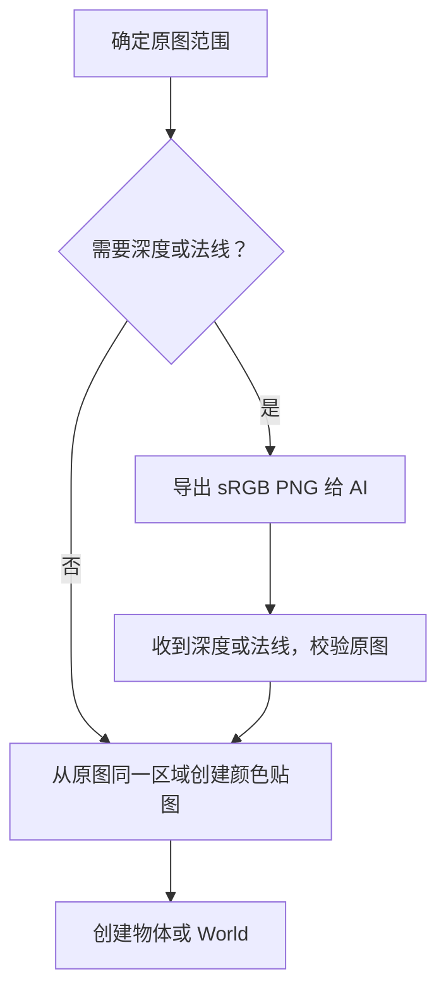

# Operator 实现索引

## Convert To 与 Cutout 的图像流程

先确定工具使用原图的哪一块。需要深度或法线时，把这块图转成 sRGB PNG 交给 AI。材质和 World 的颜色始终取自原图的同一区域，普通图打包为 PNG，HDR 打包为 32 位线性 EXR，保留高光与透明度。

| 工具 | 使用哪块原图 | AI 提供什么 | 结果 |
| --- | --- | --- | --- |
| Plane | 整图 | 无 | 矩形面片 |
| Depth Plane | 整图 | 深度、对象空间法线 | 随透视起伏的表面 |
| Relief | 整图 | 深度、切线空间法线 | 浮雕 |
| World | 最大居中 2:1 区域 | 无 | 世界环境 |
| Panorama | 最大居中 2:1 区域 | 深度、法线及烘焙权重 | 全景物体与 World，共用一张颜色贴图 |
| Cutout | 选区外接矩形，选区与源 Alpha 决定轮廓 | 面片与体块可选法线，深度形状需要深度与法线 | 沿轮廓生成的网格 |

## 源码索引

| 源码（相对 `src/anyimage/`） | 功能 |
| --- | --- |
| `operators/ai_setup.py` | [AI 环境管理](ai-setup.md) |
| `operators/clipboard_image/` | [剪贴板图片](clipboard-image.md) |
| `operators/convert_to_plane.py`、`operators/depth_plane/` | [**转为面片**、**转为凹凸面**与**转为浮雕**](convert-to-plane.md) |
| `operators/convert_to_panorama/` | [**转为立体全景**](convert-to-panorama.md) |
| `operators/cutout_tool/` | [**立体裁切**](cutout-tool.md) |
| `operators/frame_tool/operators.py` | [**重设画框**](frame.md) |
| `operators/mask_tool.py` | [**局部显隐** Alpha 编辑](mask.md) |
| `operators/rectify_tool/operators.py` | [**透视校正**](rectify.md) |
| `operators/remove_background/operators.py` | [**移除背景**](remove-background.md) |
| `operators/color_match.py` | [**色彩匹配**](color-match.md) |
| `operators/bake_mesh/operators.py` | [**烘焙网格**](bake-mesh.md) |
| BlendJob 内置 Operator | [Job 文件清理](job-files.md) |
| `operators/upscale.py` | [**2倍高清**](upscale.md) |

单文件功能按业务命名；复杂功能包在 `operators.py` 定义 Operator 和入口协调逻辑，其余模块承载具体实现。包的 `__init__.py` 导出实际使用的类型；扩展的 `__init__.py` 与 `__init_lite__.py` 分别直接导入并在 `CLASSES` 中逐项列出本版的注册类型。交互式工具的 WorkspaceTool 统一定义和注册于 `tools.py`。AI Operator 使用普通字典提交任务，并在主线程响应中读取文件和修改 Blender 数据。
