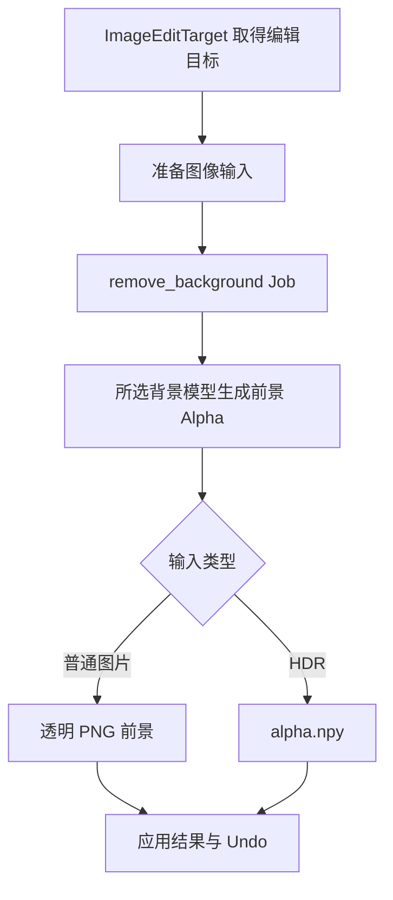

# 移除背景

`operators/remove_background/operators.py` 从 Image Empty、AnyImage 图片 Mesh 或当前 Shader Image Texture 准备输入。`RemoveImageBackground` 提供操作入口与 AI 设置检查，`RunBackgroundRemoval` 准备输入、提交 Job 并应用结果。

`server/jobs/remove_background.py` 读取单张输入并调用 `server/models/background.py`，支持 BiRefNet 和 BEN2。模型前景 Alpha 与源 Alpha 合成。

普通图片与 HDR 都提交当前像素，并通过 `ImageEditTarget` 校验源绑定、颜色解释与像素摘要，结果只影响当前目标，其他对象和纹理保留源图。HDR 使用 `operators/remove_background/hdr.py` 的 `HdrBackgroundInput` 准备分析输入，并将返回 Alpha 应用于提交时的浮点 RGB。Operator 负责临时输入清理与 Undo。
