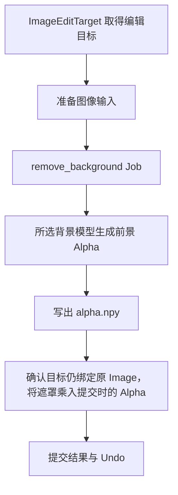

# 移除背景

`RemoveImageBackground` 从 Image Empty、Any Image 图片 Mesh 或当前 Shader Image Texture 读取像素，提交去背景任务，并在 Blender 中应用结果。

`server/jobs/remove_background.py` 调用 BiRefNet 或 BEN2 生成前景遮罩。`operators/remove_background/image.py` 的 `BackgroundInput` 保留提交时的 RGBA、颜色空间和 Alpha 模式。回填时确认目标仍绑定原 Image，再合成 Alpha。HDR 结果保留浮点 RGB。Operator 负责临时输入清理与 Undo。
