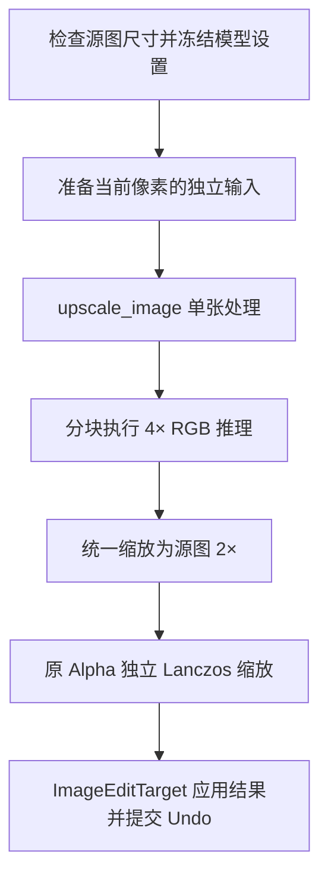

# 2倍高清

`operators/upscale.py` 从 Image Empty、Any Image 图片 Mesh 或当前 Shader Image Texture 读取静态图片，生成宽、高各为原图 2 倍的 8 位 PNG。源图长边必须小于**处理分辨率上限**。支持 8 位和 16 位 SDR 图片。彩色输入统一转为 sRGB，模型读取 8 位 RGB，输出按 sRGB 加载。Non-Color 输入沿用数据颜色空间。

`server/jobs/upscale.py` 处理输入上限、最终尺寸与 Alpha，`server/models/onnx_upscale.py` 执行 Real-ESRGAN 与 HAT 模型。ModelManager 管理 Session；Provider 资源错误会释放当前 Session 并返回处理建议。
