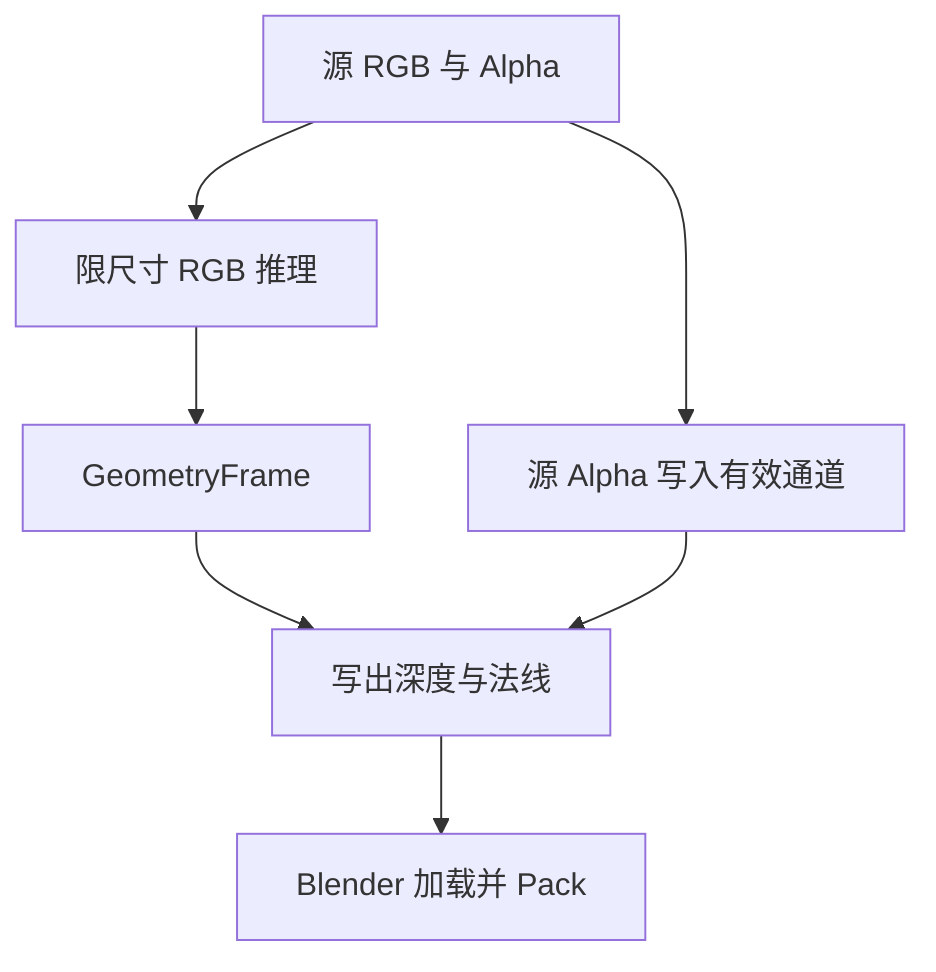

# Job 产物

Server 将结果写入 Job 目录，在结果字典中返回相对文件名和任务数据。Blender 主线程通过 JobResult 读取文件，创建或更新 Image、Mesh、Material 和 Object。

| Job | 文件 | 消费方 |
| --- | --- | --- |
| `remove_background` | `alpha.npy` | Blender 将前景遮罩应用到源图 |
| `upscale_image` | `upscale.png` | 图像替换 |
| `generate_depth_plane_geometry` | `depth.exr` 和法线贴图 | Depth / **浮雕** |
| `generate_cutout_artifacts` | `object-normal.png`，深度预设另有 `depth.exr` | **立体裁切** |
| `generate_panorama_geometry` | `depth.exr`、`object-normal.png` | **立体全景** |

## 深度与法线协议

| 返回字段 | 内容 |
| --- | --- |
| `depth` | float32 EXR，透视产物 RGB 保存相机空间 XYZ，Alpha 保存源 Alpha × 模型有效性 |
| `intrinsics` | 透视深度任务在结果字典中返回的 3×3 相机内参 |
| `tangent_normal` | `tangent-normal.png`，切线空间法线 |
| `object_normal` | `object-normal.png`，对象空间法线 |

| 功能 | 法线空间 |
| --- | --- |
| 普通面片、未请求 AI 法线的裁切 | 网格法线与颜色 Bump |
| 各种带 AI 法线的裁切、凹凸面、立体全景 | Object Space |
| 浮雕 | 按平面编码的 Tangent Space |
| Bake Mesh 生成的法线贴图 | 根据最终网格与 UV 烘焙的 Tangent Space |

参考深度由 `common/depth_geometry.py` 从产物计算：先按 Alpha 阈值和有限正深度筛选样本，剔除超过样本中位数 1.1 倍的远处背景，再取 95 分位数；无可用样本时返回基准值。加载后设置 Non-Color 和 CHANNEL_PACKED。**凹凸面**使用对象空间法线，**浮雕**使用切线空间法线，法线 PNG 均以 Non-Color 加载。

**立体全景**的 EXR RGB 保存径向距离，Alpha 保存源 Alpha 与融合有效性的乘积。全景法线 PNG 的 Alpha 保存烘焙权重。Blender 用该权重烘焙地形法线，再与天空的球面法线合成一张 RGB 贴图。

## 颜色与图像编辑

`common/color_image.py` 为**面片**、**立体全景**和**立体裁切**准备独立的材质颜色，MoGe 的输入取自 Blender 当前像素，见[图像生命周期](common.md#图像生命周期)。**立体裁切**使用 Selection bounds 内的源图；网格创建时组合源 Alpha 与 SelectionMask。颜色分辨率与分析尺寸分别处理。

`ImageEditTarget` 统一 Image Empty 和 Shader Image Texture 的编辑目标及共享引用。HDR 去背景通过 `BackgroundInput` 保留 Blender 浮点 RGB，并应用 Server 返回的连续 Alpha。
