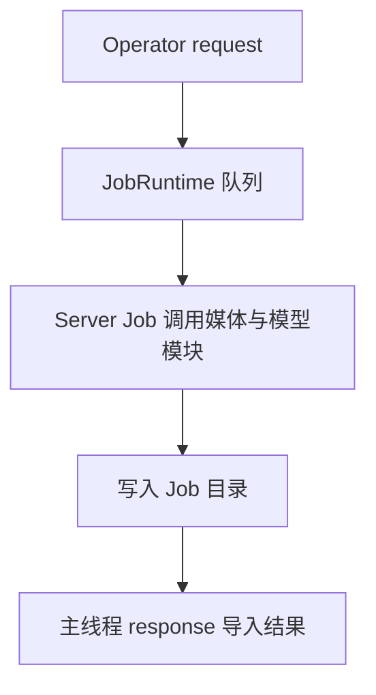

# Job Runtime 与 Server

`runtime.py` 配置 BlendJob `JobRuntime` 和独立 Python 3.12 Environment。`server/__init__.py` 注册 Job，`model_manager.py` 管理模型文件与缓存 Session。



| Job | 实现与用途 |
| --- | --- |
| `download_model`、`download_required_models` | `server/__init__.py` 下载单个或缺失模型 |
| `remove_background` | `jobs/remove_background.py` 生成透明前景或连续 Alpha |
| `upscale_image` | `jobs/upscale.py` 生成 2× 图像 |
| `generate_depth_plane_geometry` | `jobs/depth_plane.py` 生成深度、元数据和法线 |
| `generate_cutout_artifacts` | `jobs/cutout.py` 按请求生成深度和法线 |
| `generate_panorama_geometry` | `jobs/panorama.py` 生成全景径向深度与元数据 |

`media/input.py` 校验输入图片，`media/resolution.py` 限制分析尺寸，Server 处理静态图片。Job 在阶段边界直接调用 BlendJob 的 `context.check_cancelled()`；分块推理将同一回调传入处理循环。进度通过 `context.progress()` 返回，Operator 清理 Blender 导出的临时输入。

背景移除与放大的 Job 负责源图读取、模型选择、Alpha 合成和结果保存；`models/onnx_*.py` 负责各模型的输入转换与推理。背景移除先生成一份 Alpha，再按请求保存连续值或与原图 Alpha 相乘写出前景。放大将模型结果缩放为源图的两倍尺寸，并恢复对应尺寸的原图 Alpha。

`geometry/prediction_artifacts.py` 一次读取源图，分别保留 RGB、Alpha 和原始尺寸；RGB 在内存中缩放后交给 `models/geometry.py` 的 `infer_geometry()` 推理，返回统一的 `GeometryFrame`。深度、法线和元数据写入器共享这次预测及缩放到预测尺寸的 Alpha，法线保留源图尺寸。参考深度由 Blender 侧按产物 Alpha 计算，文件协议见 [Job 产物](outputs.md)。

## 界面状态

Any Image 通过 `runtime.state()` 读取统一状态，通过 `runtime.draw_server_controls(layout, setup_operator=SetupAIServer.bl_idname)` 绘制服务器状态与控制按钮。具体状态为 `UNAVAILABLE`、`INSTALLING`、`MIGRATING`、`OFFLINE`、`STARTING`、`IDLE`、`PROCESSING`、`STOPPING`、`ERROR`。Job 完成即释放处理状态。服务器启停或控制异常使用 `ERROR`，普通 Job 失败后回到空闲。

业务 Operator 继承 `JobOperator`，任务按钮使用 `runtime.can_submit()`。服务器停止、启动中、空闲或处理中都可以继续提交。安装和卸载分别判断 `UNAVAILABLE` 与 `IDLE`，未安装时保留配置引导。

```python
row.enabled = runtime.can_submit()
runtime.draw_jobs(layout)
```

BlendJob 自动在状态栏显示第一个正在运行的任务，结束后切换到下一个。`runtime.draw_jobs(layout)` 可放在任意布局，Any Image 将完整任务列表放在服务器侧边栏，每行显示进度译文和取消按钮，任务结束后移除。排队、定向取消、停止和迁移都由 BlendJob 管理；迁移自动取消全部任务，等待清理并停止服务后搬移目录。

每次调用捕获自己的目标、参数和输入快照，结果按提交顺序应用。同一图像可以连续提交，后一次结果覆盖前一次；目标删除或被用户改绑时拒绝应用。各任务独立清理临时文件。

模型状态直接读取 `runtime.resource("model_manager")`，由 Any Image 绘制已加载模型和卸载入口。

## 模型与缓存

| 用途 | 模型 | Session 分类 |
| --- | --- | --- |
| Depth 与 Normal | MoGe-2 ViT-S / ViT-B Normal、MoGe-3 ViT-L | geometry |
| **移除背景** | BiRefNet Lite、BEN2、BiRefNet HR Matting | background |
| **2倍高清** | Real-ESRGAN WDN、Real-ESRGAN x4plus、HAT Sharper | upscale |

`model_catalog.py` 声明模型 key、Fast/Base/Pro 档位、文件来源、许可、大小和 SHA-256；`model_download.py` 下载并校验。ModelManager 在 Session 创建前校验声明文件，按文件身份缓存校验结果，并按模型 key、路径和设备缓存 Session，切换模型或设备时释放对应类别。Clear Models 或关闭 Server 时释放已加载资源。

模型完成一次图片推理后释放 CUDA 临时内存；分块放大在最后一块释放，MoGe-3 的 Refiner 在第三次细化后释放。

首次安装完成后，`post_setup` 在 Blender 主线程提交模型下载 Job，下载默认 MoGe-2 ViT-S Normal、BiRefNet Lite 与 Real-ESRGAN General WDN x4v3。Storage Root 默认 `~/.anyimage`，保存环境、模型、Job 产物和日志。设置入口见 [AI 环境管理](operators/ai-setup.md)。


UI 在本地快速检查文件存在性和大小，以 Installed 表示安装状态。加载状态与 `validation_errors` 通过 Runtime 已有资源快照传递；校验失败记录模型 key 和原因，并在 Preferences 提供 Download Again。修复开始时释放目标模型 Session，下载成功后清理其校验错误和失效缓存，其他模型继续使用已有资源。
